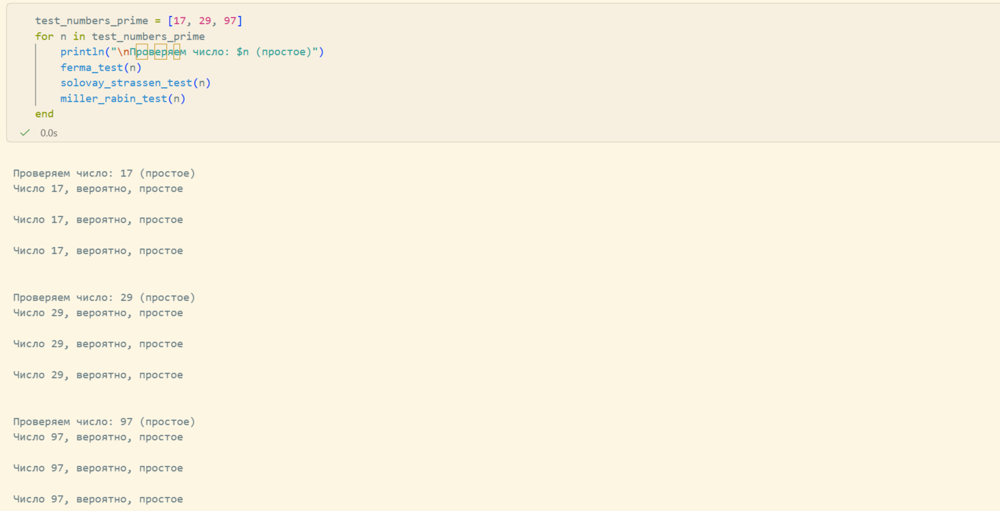
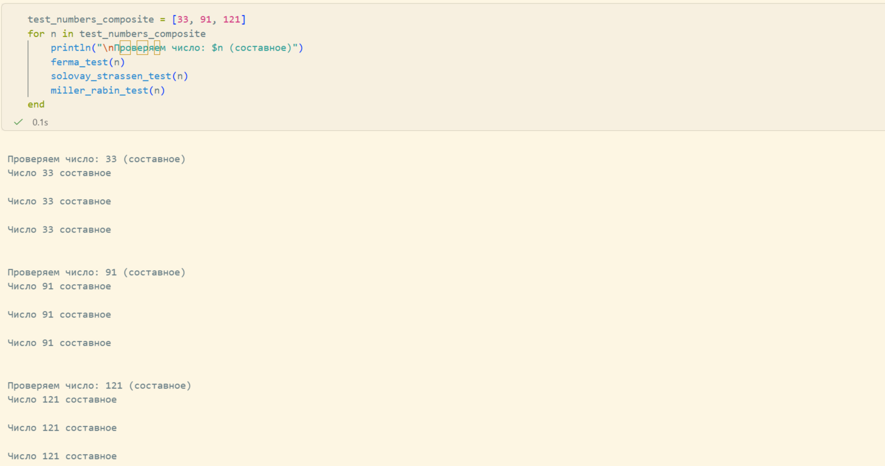

---
## Front matter
title: "Лабораторная работа №5"
subtitle: "Вероятностные алгоритмы проверки чисел на простоту"
author: "Кадрова Ангелина Александровна"

## Generic otions
lang: ru-RU
toc-title: "Содержание"

## Bibliography
bibliography: bib/cite.bib
csl: pandoc/csl/gost-r-7-0-5-2008-numeric.csl

## Pdf output format
toc: true # Table of contents
toc-depth: 2
lof: true # List of figures
lot: false # List of tables
fontsize: 12pt
linestretch: 1.5
papersize: a4
documentclass: scrreprt
## I18n polyglossia
polyglossia-lang:
  name: russian
  options:
	- spelling=modern
	- babelshorthands=true
polyglossia-otherlangs:
  name: english
## I18n babel
babel-lang: russian
babel-otherlangs: english
## Fonts
mainfont: IBM Plex Serif
romanfont: IBM Plex Serif
sansfont: IBM Plex Sans
monofont: IBM Plex Mono
mathfont: STIX Two Math
mainfontoptions: Ligatures=Common,Ligatures=TeX,Scale=0.94
romanfontoptions: Ligatures=Common,Ligatures=TeX,Scale=0.94
sansfontoptions: Ligatures=Common,Ligatures=TeX,Scale=MatchLowercase,Scale=0.94
monofontoptions: Scale=MatchLowercase,Scale=0.94,FakeStretch=0.9
mathfontoptions:
## Biblatex
biblatex: true
biblio-style: "gost-numeric"
biblatexoptions:
  - parentracker=true
  - backend=biber
  - hyperref=auto
  - language=auto
  - autolang=other*
  - citestyle=gost-numeric
## Pandoc-crossref LaTeX customization
figureTitle: "Рис."
tableTitle: "Таблица"
listingTitle: "Листинг"
lofTitle: "Список иллюстраций"
lotTitle: "Список таблиц"
lolTitle: "Листинги"
## Misc options
indent: true
header-includes:
  - \usepackage{indentfirst}
  - \usepackage{float} # keep figures where there are in the text
  - \floatplacement{figure}{H} # keep figures where there are in the text
---

# Введение

## Цели и задачи

**Цель работы**

Основная цель работы — изучить и реализовать вероятностные алгоритмы проверки чисел на простоту.

**Задание**

С помощью языка программирования Julia реализовать алгоритмы:

1. Тест Ферма;
2. Алгоритм вычисления символа Якоби;
3. Тест Соловэя-Штрассена;
4. Тест Миллера-Рабина.

## Теоретическое введение

Целое число $p \in \mathbb{Z} \setminus \{0\}$ называется *простым*, если оно не является делителем единицы и не имеет других делителей, кроме тривиальных ($\pm 1, \pm p$). В противном случае число $p \in \mathbb{Z} \setminus \{-1, 0, 1\}$ называется *составным*[@lab].

Целые числа $a$ и $b$ называются *сравнимыми по модулю* $m$ ($a \equiv b \pmod{m}$), если разность $a - b$ делится на $m$.

Алгоритмы проверки на простоту делятся на *детерминированные* (гарантированно решают задачу) и *вероятностные* (используют генератор случайных чисел и дают не гарантированно точный ответ).

Для проверки числа $n$ вероятностным алгоритмом выбирают случайное число $a$ ($1 < a < n$) и проверяют условия теста. Если $n$ не проходит тест — оно составное. Если проходит — вероятно простое. После $t$ независимых выполнений вероятность ошибки не превосходит $\frac{1}{2^t}$.

### Тест Ферма

Основан на малой теореме Ферма: для простого $p$ и $1 \leq a \leq p - 1$ выполняется:

$$a^{p-1} \equiv 1 \pmod{p}$$

Если для нечётного $n$ существует $a$, что $\text{НОД}(a, n) = 1$ и $a^{n-1} \not\equiv 1 \pmod{n}$, то $n$ составное.

### Тест Соловэя-Штрассена

Основан на критерии Эйлера: нечётное $n$ простое тогда и только тогда, когда для любого $a$, взаимно простого с $n$:

$$a^{\frac{n-1}{2}} \equiv \left(\frac{a}{n}\right) \pmod{n}$$

где $\left(\frac{a}{n}\right)$ — символ Якоби. Для $n = p_1 p_2 \ldots p_r$:

$$\left(\frac{m}{n}\right) = \left(\frac{m}{p_1}\right)\left(\frac{m}{p_2}\right) \ldots \left(\frac{m}{p_r}\right)$$

### Тест Миллера-Рабина

Пусть $n$ нечётное и $n - 1 = 2^s r$, где $r$ нечётное. Если $n$ простое, то для любого $a \geq 2$, взаимно простого с $n$, выполняется $a^{n-1} \equiv 1 \pmod{n}$. Тест проверяет дополнительные условия для повышения надёжности[@lab].

Julia — высокоуровневый свободный язык программирования с динамической типизацией, созданный для математических вычислений[@julialang].

# Выполнение лабораторной работы

## Тест Ферма

```julia
function ferma_test(n)
    if n < 5
        error("Число должно быть >= 5")
    end
    a = rand(2:(n-2))
    r = powermod(a, n-1, n)
    if r == 1
        println("Число $n, вероятно, простое\n")
        return true
    else
        println("Число $n составное\n")
        return false
    end
end
```

## Алгоритм вычисления символа Якоби
```julia
function jacobi_symbol(a, n)
    if n < 3 || n % 2 == 0
        error("n должно быть нечетным и >= 3")
    end
    if a < 0 || a >= n
        error("a должно быть в диапозоне [0,n)")
    end
    g = 1
    while true
        if a == 0
            return 0
        end
        if a == 1
            return g
        end
        k = 0
        a1 = a
        while a1 % 2 == 0
            a1 = a1 ÷ 2
            k = k + 1
        end
        if k % 2 == 0
            s = 1
        else
            n_mod_8 = n % 8
            if n_mod_8 == 1 || n_mod_8 == 7
                s = 1
            else 
                s = -1
            end
        end
        if a1 == 1
            return g * s
        end
        if n % 4 == 3 && a1 % 4 == 3
            s = -s
        end
        a = n % a1
        n = a1
        g = g * s
    end
end
```

## Тест Соловэя-Штрассена

```julia
function solovay_strassen_test(n)
    if n < 5
        error("Число должно быть >= 5")
    end
    a = rand(2:(n-2))
    exponent = (n - 1) ÷ 2 
    r = powermod(a, exponent, n)
    if r != 1 && r != n - 1
        println("Число $n составное\n")
        return false
    end
    j = jacobi_symbol(a, n)
    if r == (j % n + n) % n 
        println("Число $n, вероятно, простое\n")
        return true
    else
        println("Число $n составное\n")
        return false
    end
end
```

## Тест Миллера-Рабина

```julia
function miller_rabin_test(n)
    if n < 5
        error("Число должно быть >= 5")
    end
    r = n - 1
    s = 0
    while r % 2 == 0
        r = r ÷ 2
        s = s + 1
    end
    a = rand(2:(n-2))
    y = powermod(a, r, n)
    if y != 1 && y != n -1
        j = 1
        while j <= s - 1
            if y != n - 1
                y = powermod(y, 2, n)
                if y == 1
                    println("Число $n составное\n")
                    return false
                end
            end
            j = j + 1
        end
        if y != n - 1
            println("Число $n составное\n")
            return false
        end
    end
    println("Число $n, вероятно, простое\n")
    return true
end
```

## Тестирование алгоритмов
```julia
test_numbers_prime = [17, 29, 97]
for n in test_numbers_prime
    println("\nПроверяем число: $n (простое)")
    ferma_test(n)
    solovay_strassen_test(n)
    miller_rabin_test(n)
end

test_numbers_composite = [33, 91, 121]
for n in test_numbers_composite
    println("\nПроверяем число: $n (составное)")
    ferma_test(n)
    solovay_strassen_test(n)
    miller_rabin_test(n)
end
```

В результате получим следующий вывод(рис. [-@fig:001]-[-@fig:002]):

{#fig:001 width=100%}

{#fig:002 width=100%}


# Вывод

С помощью языка программирования Julia были реализованы вероятностные алгоритмы проверки чисел на простоту.

# Список литературы{.unnumbered}

::: {#refs}
:::

