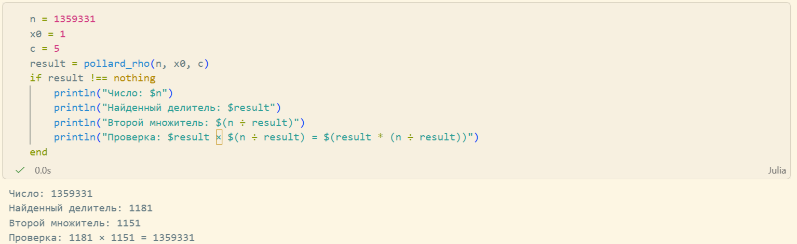

---
## Front matter
title: "Лабораторная работа №6"
subtitle: "Разложение чисел на множители"
author: "Кадрова Ангелина Александровна"

## Generic otions
lang: ru-RU
toc-title: "Содержание"

## Bibliography
bibliography: bib/cite.bib
csl: pandoc/csl/gost-r-7-0-5-2008-numeric.csl

## Pdf output format
toc: true # Table of contents
toc-depth: 2
lof: true # List of figures
lot: false # List of tables
fontsize: 12pt
linestretch: 1.5
papersize: a4
documentclass: scrreprt
## I18n polyglossia
polyglossia-lang:
  name: russian
  options:
	- spelling=modern
	- babelshorthands=true
polyglossia-otherlangs:
  name: english
## I18n babel
babel-lang: russian
babel-otherlangs: english
## Fonts
mainfont: IBM Plex Serif
romanfont: IBM Plex Serif
sansfont: IBM Plex Sans
monofont: IBM Plex Mono
mathfont: STIX Two Math
mainfontoptions: Ligatures=Common,Ligatures=TeX,Scale=0.94
romanfontoptions: Ligatures=Common,Ligatures=TeX,Scale=0.94
sansfontoptions: Ligatures=Common,Ligatures=TeX,Scale=MatchLowercase,Scale=0.94
monofontoptions: Scale=MatchLowercase,Scale=0.94,FakeStretch=0.9
mathfontoptions:
## Biblatex
biblatex: true
biblio-style: "gost-numeric"
biblatexoptions:
  - parentracker=true
  - backend=biber
  - hyperref=auto
  - language=auto
  - autolang=other*
  - citestyle=gost-numeric
## Pandoc-crossref LaTeX customization
figureTitle: "Рис."
tableTitle: "Таблица"
listingTitle: "Листинг"
lofTitle: "Список иллюстраций"
lotTitle: "Список таблиц"
lolTitle: "Листинги"
## Misc options
indent: true
header-includes:
  - \usepackage{indentfirst}
  - \usepackage{float} # keep figures where there are in the text
  - \floatplacement{figure}{H} # keep figures where there are in the text
---

# Введение

## Цели и задачи

**Цель работы**

Основная цель работы — изучить и реализовать алгоритм p-метода Полларда.

**Задание**

С помощью языка программирования Julia реализовать алгоритм p-метода Полларда.

## Теоретическое введение

Задача разложения составного числа на множители формулируется следующим образом: для данного положительного целого числа $n$ найти его каноническое разложение

$$n = p_1^{a_1} p_2^{a_2} \dots p_s^{a_s},$$

где $p_i$ — попарно различные простые числа, $a_i \geq 1$.

На практике не обязательно находить каноническое разложение числа $n$. Достаточно найти его разложение на два нетривиальных сомножителя:

$$n = pq, \qquad 1 \leq p \leq q < n.$$

**p-Метод Полларда.** Пусть $n$ — нечётное составное число, $S = \{0, 1, \dots, n-1\}$ и $f: S \to S$ — случайное отображение, обладающее сжимающими свойствами, например $f(x) \equiv x^2 + 1 \pmod{n}$. Выбираем случайный элемент $x_0 \in S$ и строим последовательность $x_0, x_1, x_2, \dots$, определяемую рекуррентным соотношением:

$$x_{i+1} = f(x_i),$$

где $i \geq 0$, до тех пор, пока не найдём такие числа $i, j$, что $i < j$ и $x_i = x_j$. Поскольку множество $S$ конечно, такие индексы существуют (последовательность «зацикливается»). Последовательность $\{x_i\}$ будет состоять из «хвоста» $x_0, x_1, \dots, x_{i-1}$ длины $O\left(\sqrt{\frac{\pi n}{8}}\right)$ и цикла $x_i = x_j, x_{i+1}, \dots, x_{j-1}$ той же длины.

**Алгоритм, реализующий p-метод Полларда.**

*Вход.* Число $n$, начальное значение $c$, функция $f$, обладающая сжимающими свойствами.

*Выход.* Нетривиальный делитель числа $n$.

1. Положить $a \leftarrow c$, $b \leftarrow c$.
2. Вычислить $a \leftarrow f(a) \pmod{n}$, $b \leftarrow f(b) \pmod{n}$.
3. Найти $d \leftarrow \text{НОД}(a - b, n)$.
4. Если $1 < d < n$, то положить $p \leftarrow d$ и результат: $p$. При $d = n$ результат: «Делитель не найден»; при $d = 1$ вернуться на шаг 2 [@lab].

Julia — высокоуровневый свободный язык программирования с динамической типизацией, созданный для математических вычислений[@julialang]-[@juliadoc].

# Выполнение лабораторной работы

## Алгоритм p-метода Полларда

Реализуем алгоритм Полларда для поиска нетривиального делителя числа.

```julia
function pollard(n, x0, c)
    f(x) = (x^2 + c) % n
    a = x0
    b = x0
    d = 1
    while d == 1
        a = f(a)
        b = f(f(b))
        d = gcd(abs(a-b), n)
    end
    if d == n
        println("Делитель не найден")
        return nothing
    else
        return d
    end
end
```

## Тестирование алгоритмов

Далее реализуем тестирование с начальными значениями: $n = 1359331$, $x_0 = 1$, $f(x) = x^2 + 5 \pmod{n}$. 
```julia
n = 1359331
x0 = 1
c = 5
result = pollard_rho(n, x0, c)
if result !== nothing
    println("Число: $n")
    println("Найденный делитель: $result")
    println("Второй множитель: $(n ÷ result)")
    println("Проверка: $result × $(n ÷ result) = $(result * (n ÷ result))")
end
```

В результате получим следующий вывод(рис. [-@fig:001]):

{#fig:001 width=100%}

# Вывод

С помощью языка программирования Julia был реализован алгоритм p-метода Полларда.

# Список литературы{.unnumbered}

::: {#refs}
:::
