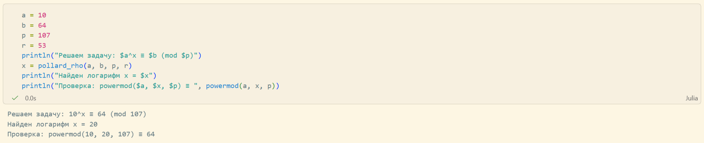

---
## Front matter
title: "Лабораторная работа №7"
subtitle: "Дискретное логарифмирование в конечном поле"
author: "Кадрова Ангелина Александровна"

## Generic otions
lang: ru-RU
toc-title: "Содержание"

## Bibliography
bibliography: bib/cite.bib
csl: pandoc/csl/gost-r-7-0-5-2008-numeric.csl

## Pdf output format
toc: true # Table of contents
toc-depth: 2
lof: true # List of figures
lot: false # List of tables
fontsize: 12pt
linestretch: 1.5
papersize: a4
documentclass: scrreprt
## I18n polyglossia
polyglossia-lang:
  name: russian
  options:
	- spelling=modern
	- babelshorthands=true
polyglossia-otherlangs:
  name: english
## I18n babel
babel-lang: russian
babel-otherlangs: english
## Fonts
mainfont: IBM Plex Serif
romanfont: IBM Plex Serif
sansfont: IBM Plex Sans
monofont: IBM Plex Mono
mathfont: STIX Two Math
mainfontoptions: Ligatures=Common,Ligatures=TeX,Scale=0.94
romanfontoptions: Ligatures=Common,Ligatures=TeX,Scale=0.94
sansfontoptions: Ligatures=Common,Ligatures=TeX,Scale=MatchLowercase,Scale=0.94
monofontoptions: Scale=MatchLowercase,Scale=0.94,FakeStretch=0.9
mathfontoptions:
## Biblatex
biblatex: true
biblio-style: "gost-numeric"
biblatexoptions:
  - parentracker=true
  - backend=biber
  - hyperref=auto
  - language=auto
  - autolang=other*
  - citestyle=gost-numeric
## Pandoc-crossref LaTeX customization
figureTitle: "Рис."
tableTitle: "Таблица"
listingTitle: "Листинг"
lofTitle: "Список иллюстраций"
lotTitle: "Список таблиц"
lolTitle: "Листинги"
## Misc options
indent: true
header-includes:
  - \usepackage{indentfirst}
  - \usepackage{float} # keep figures where there are in the text
  - \floatplacement{figure}{H} # keep figures where there are in the text
---

# Введение

## Цели и задачи

**Цель работы**

Основная цель работы — изучить и реализовать алгоритм Полларда для дискретного логарифмирования в конечном поле.

**Задание**

С помощью языка программирования Julia реализовать алгоритм Полларда для дискретного логарифмирования в конечном поле.

## Теоретическое введение

Задача дискретного логарифмирования применяется во многих алгоритмах криптографии с открытым ключом. 

Обозначим $F_p = \mathbb{Z}/p\mathbb{Z}$, где $p$ — простое целое число, и назовем его конечным полем из $p$ элементов. Задача дискретного логарифмирования в конечном поле формулируется так: для данных целых чисел $a$ и $b$ ($a > 1$, $b < p$) найти логарифм — такое целое число $x$, что $a^x \equiv b \pmod p$.

Безопасность соответствующих криптосистем основана на том, что, зная числа $a, x, p$, вычислить $a^x \pmod p$ легко, а решить задачу дискретного логарифмирования трудно. 

Для решения задачи применяется $\rho$-метод Полларда. При этом случайное отображение $f$ должно обладать сжимающими свойствами и вычислимостью логарифма. В качестве случайного отображения $f$ обычно используют ветвящиеся отображения, например:
$$
f(c) = 
\begin{cases} 
a \cdot c, & \text{при } c < p/2 \\
b \cdot c, & \text{при } c > p/2 
\end{cases}
$$

При $c < p/2$ имеем $\log_a f(c) = \log_a c + 1$, при $c > p/2$ — $\log_a f(c) = \log_a c + x$. 

Алгоритм, реализующий p-Метод Полларда для задач дискретного логарифмирования:

**Вход.** Простое число $p$, число $a$ порядка $r$ по модулю $p$, целое число $b$, $1 < b < p$; отображение $f$, обладающее сжимающими свойствами и сохраняющее вычислимость логарифма.

**Выход.** Показатель $x$, для которого $a^x \equiv b \pmod p$, если такой показатель существует.
1. Выбрать произвольные целые числа $u, v$ и положить $c = a^u \cdot b^v \pmod p$, $d = c$.
2. Выполнять $c = f(c) \pmod p$, $d = f(f(d)) \pmod p$, вычисляя при этом логарифмы для $c$ и $d$ как линейные функции от $x$ по модулю $r$, до получения равенства $c = d \pmod p$.
3. Приравняв логарифмы для $c$ и $d$, вычислить логарифм $x$ решением сравнения по модулю $r$. Результат: $x$ или "Решения нет"[@lab].

Julia — высокоуровневый свободный язык программирования с динамической типизацией, созданный для математических вычислений[@julialang]-[@juliadoc].

# Выполнение лабораторной работы

## Алгоритм p-метода Полларда

Реализуем алгоритм Полларда для дискретного логарифмирования в конечном поле.

```julia
function next_step(val, u, v, a, b, p, r)
    if val < div(p, 2)
        return (a * val) % p, (u + 1) % r, v
    else
        return (b * val) % p, u, (v + 1) % r
    end
end

function pollard_rho(a, b, p, r)
    u = 2
    v = 2
    c = (powermod(a, u, p) * powermod(b, v, p)) % p
    d = c
    uc, vc = u, v
    ud, vd = u, v
    while true
        c, uc, vc = next_step(c, uc, vc, a, b, p, r)
        d, ud, vd = next_step(d, ud, vd, a, b, p, r)
        d, ud, vd = next_step(d, ud, vd, a, b, p, r)
        if c == d
            break
        end
    end
    A = (vc - vd) % r
    B = (ud - uc) % r 
    if A == 0
        if B == 0
            return "Тривиальное совпадение"
        else
            return "Решения нет"
        end
    end
    x = (B * invmod(A, r)) % r
    return x
end
```

## Тестирование алгоритма
 
```julia
a = 10
b = 64
p = 107
r = 53
println("Решаем задачу: $a^x = $b (mod $p)")
x = pollard_rho(a, b, p, r)
println("Найден логарифм x = $x")
println("Проверка: powermod($a, $x, $p) = ", powermod(a, x, p))
```

В результате получим следующий вывод(рис. [-@fig:001]):

{#fig:001 width=100%}

# Вывод

С помощью языка программирования Julia был реализован алгоритм Полларда для дискретного логарифмирования в конечном поле.

# Список литературы{.unnumbered}

::: {#refs}
:::
