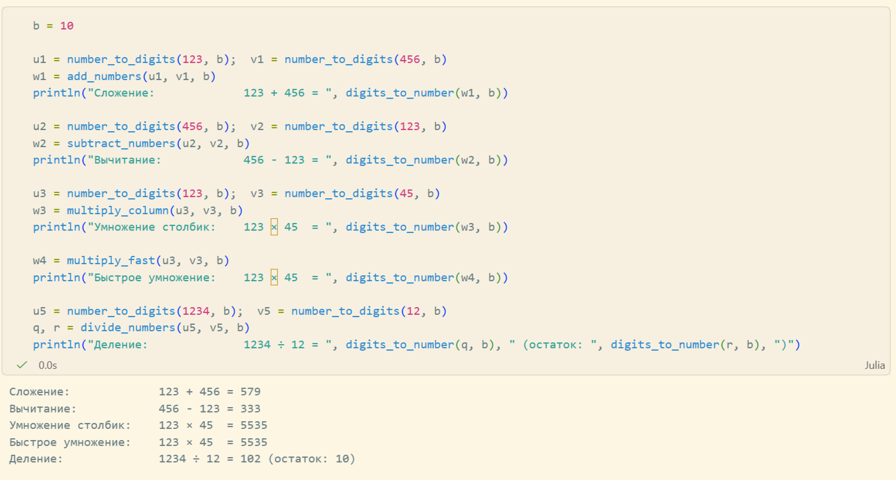

---
## Front matter
lang: ru-RU
title: Лабораторная работа №8
subtitle: "Целочисленная арифметика многократной точности"
author:
  - Кадрова Ангелина Александровна
teacher:
  - Кулябов Д. С.
  - д.ф.-м.н., профессор
  - профессор кафедры теории вероятностей и кибербезопасности 
institute:
  - Российский университет дружбы народов имени Патриса Лумумбы, Москва, Россия

## i18n babel
babel-lang: russian
babel-otherlangs: english

## Formatting pdf
toc: false
toc-title: Содержание
slide_level: 2
aspectratio: 169
section-titles: true
theme: metropolis
header-includes:
 - \metroset{progressbar=frametitle,sectionpage=progressbar,numbering=fraction}
---

## Докладчик

:::::::::::::: {.columns align=center}
::: {.column width="70%"}

  * Кадрова Ангелина Александровна
  * Cтудентка НФИмд-02-26
  * Российский университет дружбы народов имени Патриса Лумумбы
  * [1032262509@rudn.ru](mailto:1032262509@rudn.ru)
  * <https://github.com/aakadrova>

:::
::: {.column width="30%"}


:::
::::::::::::::

## Цели и задачи

**Цель работы**

Основная цель работы — изучить и реализовать алгоритмы целочисленной арифметики многократной точности.

**Задание**

С помощью языка программирования Julia реализовать:

- Алгоритм сложения неотрицательных целых чисел
- Алгоритм вычитания неотрицательных целых чисел
- Алгоритм умножения неотрицательных целых чисел (столбиком)
- Алгоритм умножения неотрицательных целых чисел (быстрый столбик)
- Алгоритм деления многоразрядных целых чисел.

## Теоретическое введение

В данной работе рассмотрим алгоритмы для выполнения арифметических операций с большими целыми числами. Будем считать, что число записано в $b$-ичной системе счисления, $b$ -- натуральное число, $b \geq 2$. Натуральное $n$-разрядное число будем записывать в виде

$$u = u_1 u_2 \ldots u_n$$

При работе с большими целыми числами знак такого числа удобно хранить в отдельной переменной. Например, при умножении двух чисел, знак произведения вычисляется отдельно. Квадратные скобки обозначают, что берется целая часть числа.

## Алгоритм 1 (сложение неотрицательных целых чисел)

**Вход.** Два неотрицательных числа $u = u_1 u_2 \ldots u_n$ и $v = v_1 v_2 \ldots v_n$; разрядность чисел $n$; основание системы счисления $b$.

**Выход.** Сумма $w = w_0 w_1 \ldots w_n$, где $w_0$ -- цифра переноса -- всегда равна 0 либо 1.

1. Присвоить $j := n$, $k := 0$ ($j$ идет по разрядам, $k$ следит за переносом).
2. Присвоить $w_j := (u_j + v_j + k) \pmod b$, где $w_j$ -- наименьший неотрицательный вычет в данном классе вычетов; $k := \left\lfloor\frac{u_j + v_j + k}{b}\right\rfloor$.
3. Присвоить $j := j - 1$. Если $j > 0$, то возвращаемся на шаг 2; если $j = 0$, то присвоить $w_0 := k$ и результат: $w$.

## Алгоритм 2 (вычитание неотрицательных целых чисел)

**Вход.** Два неотрицательных числа $u = u_1 u_2 \ldots u_n$ и $v = v_1 v_2 \ldots v_n$, $u > v$; разрядность чисел $n$; основание системы счисления $b$.

**Выход.** Разность $w = w_1 w_2 \ldots w_n = u - v$.

1. Присвоить $j := n$, $k := 0$ ($k$ -- заем из старшего разряда).
2. Присвоить $w_j := (u_j - v_j + k) \pmod b$, где $w_j$ -- наименьший неотрицательный вычет в данном классе вычетов; $k := \left\lfloor\frac{u_j - v_j + k}{b}\right\rfloor$.
3. Присвоить $j := j - 1$. Если $j > 0$, то возвращаемся на шаг 2; если $j = 0$, то результат: $w$.

## Алгоритм 3 (умножение неотрицательных целых чисел столбиком)

**Вход.** Числа $u = u_1 u_2 \ldots u_n$, $v = v_1 v_2 \ldots v_m$; основание системы счисления $b$.

**Выход.** Произведение $w = uv = w_1 w_2 \ldots w_{m+n}$.

1. Выполнить присвоения: $w_{m+1} := 0, w_{m+2} := 0, \ldots, w_{m+n} := 0$, $j := m$ ($j$ перемещается по номерам разрядов числа $v$ от младших к старшим).
2. Если $v_j = 0$, то присвоить $w_j := 0$ и перейти на шаг 6.
3. Присвоить $i := n$, $k := 0$ (Значение $i$ идет по номерам разрядов числа $u$, $k$ отвечает за перенос).
4. Присвоить $t := u_i \cdot v_j + w_{i+j} + k$, $w_{i+j} := t \pmod b$, $k := \frac{t}{b}$, где $w_{i+j}$ -- наименьший неотрицательный вычет в данном классе вычетов.
5. Присвоить $i := i - 1$. Если $i > 0$, то возвращаемся на шаг 4, иначе присвоить $w_j := k$.
6. Присвоить $j := j - 1$. Если $j > 0$, то вернуться на шаг 2. Если $j = 0$, то результат: $w$.

## Алгоритм 4 (быстрый столбик)

**Вход.** Числа $u = u_1 u_2 \ldots u_n$, $v = v_1 v_2 \ldots v_m$; основание системы счисления $b$.

**Выход.** Произведение $w = uv = w_1 w_2 \ldots w_{m+n}$.

1. Присвоить $t := 0$.
2. Для $s$ от 0 до $m + n - 1$ с шагом 1 выполнить шаги 3 и 4.
3. Для $i$ от 0 до $s$ с шагом 1 выполнить присвоение $t := t + u_{n-i} \cdot v_{m-s+i}$.
4. Присвоить $w_{m+n-s} := t \pmod b$, $t := \frac{t}{b}$, где $w_{m+n-s}$ -- наименьший неотрицательный вычет по модулю $b$. Результат: $w$.

## Алгоритм 5 (деление многоразрядных целых чисел)

**Вход.** Числа $u = u_n \ldots u_1 u_0$, $v = v_t \ldots v_1 v_0$, $n \geq t \geq 1$, $v_t \neq 0$, разрядность чисел соответственно $n$ и $t$.

**Выход.** Частное $q = q_{n-t} \ldots q_0$, остаток $r = r_t \ldots r_0$.

1. Для $j$ от 0 до $n - t$ присвоить $q_j := 0$.
2. Пока $u \geq v b^{n-t}$, выполнять: $q_{n-t} := q_{n-t} + 1$, $u := u - v b^{n-t}$.
3. Для $i = n, n-1, \ldots, t+1$ выполнять пункты 3.1 -- 3.4:
   - 3.1 если $u_i \geq v_t$, то присвоить $q_{i-t-1} := b - 1$, иначе присвоить $q_{i-t-1} := \frac{u_i b + u_{i-1}}{v_t}$.
   - 3.2 пока $q_{i-t-1}(v_t b + v_{t-1}) > u_i b^2 + u_{i-1} b + u_{i-2}$ выполнять $q_{i-t-1} := q_{i-t-1} - 1$.
   - 3.3 присвоить $u := u - q_{i-t-1} b^{i-t-1} v$.
   - 3.4 если $u < 0$, то присвоить $u := u + v b^{i-t-1}$, $q_{i-t-1} := q_{i-t-1} - 1$.
4. $r := u$. Результат: $q$ и $r$.

## Вспомогательные функции

Для работы с числами в $b$-ичной системе счисления реализуем вспомогательные функции преобразования:

```julia
function number_to_digits(num, b)
    if num == 0
        return [0]
    end
    digits = Int[]
    n = num
    while n > 0
        pushfirst!(digits, n % b)
        n ÷= b
    end
    return digits
end
```

## Вспомогательные функции

```julia
function digits_to_number(digits, b)
    result = 0
    for d in digits
        result = result * b + d
    end
    return result
end
function remove_leading_zeroes(w)
    idx = 1
    while idx < length(w) && w[idx] == 0
        idx += 1
    end
    return w[idx:end]
end
```

## Алгоритм 1: Сложение неотрицательных целых чисел

```julia
function add_numbers(u, v, b)
    n = length(u)
    w = zeros(Int, n + 1)
    k = 0
    j = n
    while j > 0
        sum_val = u[j] + v[j] + k
        w[j + 1] = sum_val % b
        k = sum_val ÷ b
        j -= 1
    end
    w[1] = k
    return remove_leading_zeroes(w)
end
```

## Алгоритм 2: Вычитание неотрицательных целых чисел

```julia
function subtract_numbers(u, v, b)
    n = length(u)
    w = zeros(Int, n)
    k = 0
    j = n
    while j > 0
        diff_val = u[j] - v[j] + k
        w[j] = mod(diff_val, b)
        k = fld(diff_val, b)
        j -= 1
    end
    return remove_leading_zeroes(w)
end
```

## Алгоритм 3: Умножение столбиком

```julia
function multiply_column(u, v, b)
    n = length(u)
    m = length(v)
    w = zeros(Int, m + n)
    j = m
    while j > 0
        if v[j] != 0 
            k = 0
            i = n
```

## Алгоритм 3: Умножение столбиком
```julia
            while i > 0
                t = u[i] * v[j] + w[i + j] + k
                w[i + j] = t % b
                k = t ÷ b
                i -= 1
            end
            w[j] += k
        end
        j -= 1
    end
    return remove_leading_zeroes(w)
end
```

## Алгоритм 4: Быстрое умножение

```julia
function multiply_fast(u, v, b)
    n = length(u)
    m = length(v)
    w = zeros(Int, n + m)
    t = 0
    for s in 0:(m + n - 1)
        for i in 0:s
            iu = n - i
            iv = m - s + i
```

## Алгоритм 4: Быстрое умножение
```julia
            if 1 <= iu <= n && 1 <= iv <= m
                t += u[iu] * v[iv]
            end
        end
        w[m + n - s] = t % b
        t = t ÷ b
    end
    return remove_leading_zeroes(w)
end
```

## Алгоритм 5: Деление многоразрядных целых чисел

```julia
function divide_numbers(u_digits, v_digits, b)
    u = digits_to_number(u_digits, b)
    v = digits_to_number(v_digits, b)
    if v == 0 
        throw(DomainError("Деление на ноль"))
    end
    if u < v
        return [0], u_digits
    end
    n = floor(Int, log(b, u))
    t = floor(Int, log(b, v))
    function get_digit(num, i)
        i < 0 && return 0
        return (num ÷ b^i) % b
    end
```

## Алгоритм 5: Деление многоразрядных целых чисел
```julia
    q = zeros(Int, n - t + 1)
    while u >= v * b^(n-t)
        q[n - t + 1] += 1
        u -= v * b^(n - t)
    end
    for i in n:-1:(t+1)
        u_i = get_digit(u, i)
        v_t = get_digit(v, t)
        if u_i >= v_t
            q[i-t] = b - 1
        else
            u_i_1 = get_digit(u, i-1)
            q[i-t] = (u_i * b + u_i_1) ÷ v_t
        end
```

## Алгоритм 5: Деление многоразрядных целых чисел
```julia
        v_t_1 = get_digit(v, t-1)
        u_i_1 = get_digit(u, i-1)
        u_i_2 = get_digit(u, i-2)
        while q[i - t] * (v_t * b + v_t_1) > u_i * b^2 + u_i_1 * b + u_i_2
            q[i - t] -= 1
        end
        u -= q[i - t] * b^(i-t-1) * v
        if u < 0
            u += v * b^(i-t-1)
            q[i-t] -= 1
        end
    end
```

## Алгоритм 5: Деление многоразрядных целых чисел
```julia
    r = u
    q_digits = number_to_digits(digits_to_number(reverse(q), b), b)
    r_digits = number_to_digits(r, b)
    return q_digits, r_digits
end
```

## Тестирование алгоритмов
 
```julia
b = 10

u1 = number_to_digits(123, b);  v1 = number_to_digits(456, b)
w1 = add_numbers(u1, v1, b)
println("Сложение:             123 + 456 = ", digits_to_number(w1, b))

u2 = number_to_digits(456, b);  v2 = number_to_digits(123, b)
w2 = subtract_numbers(u2, v2, b)
println("Вычитание:            456 - 123 = ", digits_to_number(w2, b))

u3 = number_to_digits(123, b);  v3 = number_to_digits(45, b)
w3 = multiply_column(u3, v3, b)
println("Умножение столбик:    123 × 45  = ", digits_to_number(w3, b))

```

## Тестирование алгоритмов
 
```julia

w4 = multiply_fast(u3, v3, b)
println("Быстрое умножение:    123 × 45  = ", digits_to_number(w4, b))

u5 = number_to_digits(1234, b);  v5 = number_to_digits(12, b)
q, r = divide_numbers(u5, v5, b)
println("Деление:              1234 ÷ 12 = ", digits_to_number(q, b), " (остаток: ", digits_to_number(r, b), ")")
```

## Тестирование алгоритмов

{#fig:001 width=90%}

## Вывод

С помощью языка программирования Julia были реализованы алгоритмы целочисленной арифметики многократной точности.
